### Избранные проекты

**В работе:** Python · JavaScript · Node.js · FastAPI · Aiogram · SQLite · .NET · Linux

[Портфолио ↗](https://adjabkhanian.ru) · [Отзывы заказчиков ↗](https://adjabkhanian.ru/reviews/) · [Обсудить проект ↗](https://adjabkhanian.ru/#contact)
